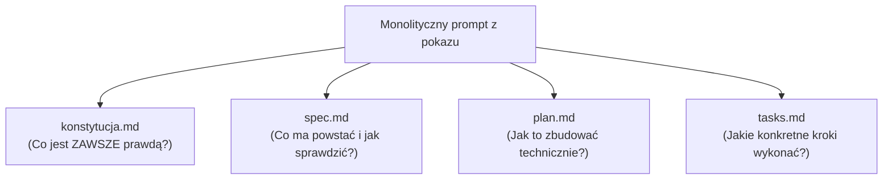

# Notatnik-V2

Projekt aplikacji desktopowej **Notatnik-V2** tworzony z myślą o przyszłej implementacji w technologii **C#**, **.NET**, **Avalonia UI** (https://avalonia.app/) oraz **XAML** (`.axaml`).

Na obecnym etapie repozytorium zawiera dokumentację architektoniczną i projektową (konstytucję projektu, rejestr decyzji architektonicznych ADR oraz pełną specyfikację modułu notatnika wraz z planem i zadaniami) – przygotowaną zgodnie z metodyką Spec-Driven Development.

---

## 1. Rozsortowanie 12 zdań projektowych

Poniższa tabela przedstawia klasyfikację 12 zdań projektowych do jednego z czterech kluczowych miejsc w dokumentacji i procesie inżynierii oprogramowania:
- **Plik reguł (`AGENTS.md`)** – instrukcje operacyjne, ograniczenia edycyjne i zasady stylu kodowania skierowane do programisty lub autonomicznego agenta programistycznego AI.
- **Specyfikacja** – szczegółowe wymagania funkcjonalne i niefunkcjonalne (UI, interakcja, stany kontrolek, SLA wydajnościowe) definiujące zachowanie konkretnej wersji aplikacji.
- **Konstytucja** – fundamentalne, niezmienne i nadrzędne zasady całego projektu, obowiązujące zawsze niezależnie od wersji czy nowych funkcji.
- **Zapis decyzji (ADR)** – udokumentowany wybór techniczny lub architektoniczny wraz z kontekstem, uzasadnieniem, odrzuconymi alternatywami i kompromisami.

### Tabela klasyfikacji zdań

| Nr | Treść zdania | Przypisane miejsce | Krótkie uzasadnienie |
| :-: | :--- | :--- | :--- |
| **1** | Metoda nie może być dłuższa niż dwadzieścia linii. | **Plik reguł (`AGENTS.md`)** | Techniczna wytyczna czystości kodu i stylu programowania kierowana do programisty/agenta AI tworzącego implementację. |
| **2** | Program nie wymaga połączenia z internetem. | **Konstytucja** | Niezmienna, nadrzędna zasada prywatności i architektury offline-first obowiązująca w całym cyklu życia projektu. |
| **3** | Kiedy tytuł notatki jest pusty, przycisk zapisu jest nieaktywny. | **Specyfikacja** | Szczegółowe wymaganie funkcjonalne dotyczące logiki interfejsu użytkownika (UI) oraz stanu konkretnej kontrolki. |
| **4** | Wybraliśmy Markdown zamiast JSON, bo plik ma być czytelny w edytorze. | **Zapis decyzji (ADR)** | Uzasadnienie kompromisu technologicznego i wyboru formatu danych w kontekście alternatyw. |
| **5** | Program jest dla jednej osoby na jednym komputerze. | **Konstytucja** | Fundamentalne założenie architektoniczne determinujące jednoosobowy, lokalny charakter całego projektu. |
| **6** | Komunikaty o błędach są po polsku. | **Specyfikacja** | Wymaganie funkcjonalne dotyczące warstwy prezentacji i języka komunikatów walidacyjnych widocznych dla użytkownika. *(Zdanie dwuznaczne)* |
| **7** | Notatki sortujemy od najnowszej. | **Specyfikacja** | Wymaganie funkcjonalne definiujące domyślny sposób prezentacji i sortowania danych na liście notatek. |
| **8** | Nie zmieniaj plików, o które nie było prośby. | **Plik reguł (`AGENTS.md`)** | Wytyczna dyscypliny operacyjnej ograniczająca zakres modyfikacji kodu przez agenta AI do żądanego zakresu. |
| **9** | Dane nigdy nie opuszczają komputera użytkownika. | **Konstytucja** | Nadrzędna, nienegocjowalna reguła bezpieczeństwa i suwerenności danych użytkownika. |
| **10** | Wszystkie pliki w UTF-8. | **Plik reguł (`AGENTS.md`)** | Dyrektywa techniczna dotycząca standardu kodowania plików źródłowych w repozytorium przez edytory/agenta. *(Zdanie dwuznaczne)* |
| **11** | Program uruchamia się w mniej niż dwie sekundy. | **Specyfikacja** | Niefunkcjonalne wymaganie jakościowe (Quality Attribute / SLA) weryfikowane podczas testów akceptacyjnych wydania. |
| **12** | Zrezygnowaliśmy z wyszukiwania w tej wersji, bo wydłużyłoby tydzień o drugi. | **Zapis decyzji (ADR)** | Zapis kompromisu projektowego (trade-off) i uzasadnienie świadomego cięcia zakresu funkcjonalnego ze względów harmonogramowych. |

---

## 2. Wyjaśnienie zdań dwuznacznych

W powyższym zestawie dwa zdania mają charakter dwuznaczny, a ich prawidłowe przypisanie zależy ściśle od kontekstu interpretacji:

### Dwuznaczność 1: Zdanie 10 – *„Wszystkie pliki w UTF-8.”*
- **Wariant A – Plik reguł (`AGENTS.md`)**: Jeśli pojęcie „pliki” odnosi się do warsztatu pracy dewelopera / agenta AI oraz plików źródłowych w repozytorium (`.cs`, `.axaml`, `.md`, pliki konfiguracyjne), zdanie to stanowi techniczną regułę zapisu plików źródłowych, zapobiegającą uszkodzeniom kodowania w systemie Git.
- **Wariant B – Specyfikacja (lub Konstytucja)**: Jeśli zdanie odnosi się do plików danych tworzonych, odczytywanych i zapisywanych przez aplikację w czasie jej działania (np. plik `notatki.md`), wówczas stanowi ono wymaganie specyfikacji formatu wejścia/wyjścia (I/O) programu, będące praktyczną realizacją konstytucyjnej zasady obsługi języka polskiego.
- **Od czego zależy przypisanie**: Zależy od tego, czy reguła dotyczy **procesu wytwarzania kodu w repozytorium** (wtedy: `AGENTS.md`), czy **działania gotowej aplikacji i zapisu danych użytkownika** (wtedy: `Specyfikacja`).

### Dwuznaczność 2: Zdanie 6 – *„Komunikaty o błędach są po polsku.”*
- **Wariant A – Specyfikacja**: Gdy zdanie określa zachowanie interfejsu graficznego (UI) – teksty wyświetlane w oknach dialogowych, kontrolkach tekstowych, walidacji formularza dodawania notatki (np. komunikat: „Tytuł nie może być pusty”). Wówczas jest to klasyczne wymaganie specyfikacji funkcjonalnej interfejsu użytkownika.
- **Wariant B – Plik reguł (`AGENTS.md`)**: Gdy zdanie stanowi wytyczną dla programisty lub agenta AI implementującego kod C#, nakazującą tworzenie komunikatów wyjątków (`throw new Exception("Błąd...")`), treści logów diagnostycznych czy komentarzy w języku polskim (szczególnie w projektach, gdzie nazwy klas i metod są po angielsku, a komunikaty po polsku).
- **Wariant C – Konstytucja**: Może być również interpretowane jako bezpośrednia konsekwencja nadrzędnej reguły konstytucyjnej: *„Interfejs aplikacji jest w języku polskim i obsługuje polskie znaki”*.
- **Od czego zależy przypisanie**: Zależy od tego, czy odbiorcą komunikatu o błędzie jest **użytkownik końcowy w interfejsie graficznym** (wtedy: `Specyfikacja`), czy **programista analizujący kod źródłowy i wyjątki w logach** (wtedy: `AGENTS.md`).

---

## 3. Zasada z oficjalnego szablonu konstytucji Spec Kit

- **Oficjalne repozytorium**: [GitHub Spec-Kit](https://github.com/github/spec-kit)
- **Źródło szablonu konstytucji**: [`templates/constitution-template.md`](https://github.com/github/spec-kit/blob/main/templates/constitution-template.md)
- **Data odczytania**: 05.11.2026

### Zacytowana zasada z szablonu

> **`III. Test-First (NON-NEGOTIABLE)`**  
> *"TDD mandatory: Tests written → User approved → Tests fail → Then implement; Red-Green-Refactor cycle strictly enforced"*

*(W tłumaczeniu: „Bezwzględny wymóg Test-First (Nienegocjowalny): Obowiązkowe TDD: Najpierw pisane testy → Zatwierdzone przez użytkownika → Sprawdzenie, że testy zawodzą → Dopiero potem implementacja; Cykl Red-Green-Refactor bezwzględnie egzekwowany”).*

### Wyjaśnienie, dlaczego ta zasada w rozbudowanej formie byłaby bez sensu dla prostego notatnika

W zaawansowanych bibliotekach szkieletowych, narzędziach CLI dla agentów oraz systemach klasy enterprise (takich jak `spec-kit`), rygorystyczny proces TDD z formalnym etapem zatwierdzania każdego testu przez użytkownika przed napisaniem jakiejkolwiek linijki kodu chroni przed kosztownymi regresjami w złożonej sieci modułów.

Jednak w przypadku prostego, jednoosobowego notatnika desktopowego w technologii Avalonia UI, taka rozbudowana i biurokratyczna zasada byłaby skrajnym **przerostem formy nad treścią (overengineering)**:
1. **Paraliż szybkiego prototypowania UI**: Tworzenie widoków w XAML i prostych kontrolek (pole tekstowe, przycisk, lista) wymaga zwinnego dopasowywania interfejsu. Wymóg pisania pełnych testów jednostkowych i akceptacyjnych z wymogiem formalnego zatwierdzenia przez użytkownika przed dodaniem prostego przycisku drastycznie wydłużyłby czas prac bez żadnej realnej korzyści jakościowej.
2. **Nieproporcjonalny koszt utrzymania**: W prostym programie desktopowym narzut na formalizm TDD przekroczyłby wielokrotnie nakład pracy potrzebny na stworzenie samej logiki zapisu do pliku.
3. **Koncentracja na niewłaściwym aspekcie**: Dla Notatnika-V2 kluczowe są proste, niezmienne fundamenty architektoniczne (zapis w czytelnym formacie Markdown, praca lokalna bez dostępu do sieci, polski interfejs), a nie rygorystyczne procedury korporacyjnego cyklu wytwórczego.

---

## 4. Pięć obowiązkowych kryteriów akceptacji w formacie sprawdzalnym

Poniższe zestawienie stanowi przekształcenie pięciu potocznych, niejednoznacznych zdań projektowych w precyzyjne, mierzalne i bezwzględnie weryfikowalne kryteria akceptacji w formacie: **„Kiedy ..., to ...”** wraz ze **„Sprawdzenie: ...”**.

### 1. „Program obsługuje polskie znaki.”
- **Sytuacja**: Użytkownik uruchamia program i otwiera formularz nowej notatki, w którym wpisuje w tytule: `Zażółć gęślą jaźń ZAŻÓŁĆ GĘŚLĄ JAŹŃ`, a w treści: `Pchnąć w tę łódź jeża lub ośm skrzyń fig`, po czym klika przycisk zapisu.
- **Kryterium**: **Kiedy** użytkownik zapisze notatkę zawierającą polskie znaki diakrytyczne (małe i wielkie: ą, ć, ę, ł, ń, ó, ś, ź, ż), **to** w oknie głównym na liście notatek, w panelu podglądu oraz w docelowym pliku tekstowym znaki te są wyświetlane i zapisywane bez zniekształceń, zamiany na encje, znaków zapytania czy nieczytelnych symboli (tzw. krzaczków).
- **Sprawdzenie**: 
  1. Zweryfikować wzrokowo w interfejsie graficznym poprawność wyświetlania wprowadzonych liter diakrytycznych na liście oraz w oknie podglądu.
  2. Otworzyć plik danych w zewnętrznym edytorze tekstu (np. Notatnik Windows) przy wymuszonym kodowaniu UTF-8 i sprawdzić, czy tekst jest w pełni czytelny i identyczny z wprowadzonym.

### 2. „Lista notatek jest zawsze aktualna.”
- **Sytuacja**: Program jest uruchomiony i prezentuje dotychczas zapisaną listę notatek. Użytkownik wprowadza nową notatkę z unikalnym tytułem `Notatka testowa aktualności` i klika przycisk zapisu.
- **Kryterium**: **Kiedy** nastąpi pomyślny zapis nowej notatki, **to** nowo utworzona notatka pojawia się natychmiast na samej górze listy notatek (pozycja indeksu 0) z właściwym tytułem i datą, bez konieczności ponownego uruchamiania aplikacji ani manualnego odświeżania widoku przez użytkownika.
- **Sprawdzenie**: 
  1. Zaobserwować stan listy bezpośrednio po kliknięciu przycisku zapisu – całkowita liczba elementów na liście musi wzrosnąć dokładnie o jeden.
  2. Sprawdzić, czy pierwszy element od góry listy posiada tytuł wpisany w formularzu oraz aktualny znacznik czasu.

### 3. „Zapis jest bezpieczny.”
- **Sytuacja**: Na dysku istnieje plik zawierający wcześniejsze notatki użytkownika. Następuje operacja zapisu nowej notatki lub dochodzi do błędu środowiskowego podczas operacji zapisu (np. brak uprawnień zapisu do pliku, symulacja awarii I/O).
- **Kryterium**: **Kiedy** użytkownik wykonuje zapis notatki, **to** program wykonuje operację w sposób gwarantujący nienaruszalność dotychczasowych wpisów – wcześniejsze notatki nie ulegają skasowaniu ani uszkodzeniu, a w sytuacji błędu zapisu aplikacja nie ulega awarii (brak crashu), lecz wyświetla czytelny komunikat po polsku, pozostawiając istniejący plik danych w nienaruszonym stanie (brak pliku pustego / zerobajtowego).
- **Sprawdzenie**: 
  1. Sprawdzić plik bazy przed i po normalnym zapisie nowej notatki – plik musi zawierać wszystkie wcześniejsze wpisy powiększone o nowy wpis.
  2. Zasymulować blokadę pliku (np. ustawienie atrybutu „Tylko do odczytu” lub blokada praw zapisu) i kliknąć przycisk zapisu – zweryfikować, czy aplikacja wyświetliła polski komunikat o błędzie zapisu, a zawartość oryginalnego pliku pozostała w 100% nienaruszona.

### 4. „Pusta notatka nie jest zapisywana.”
- **Sytuacja**: Formularz tworzenia notatki posiada puste pole tytułu lub pole tytułu wypełnione wyłącznie białymi znakami (spacje, tabulatory), niezależnie od tego, czy pole treści zawiera tekst, czy jest puste.
- **Kryterium**: **Kiedy** pole tytułu notatki jest puste lub zawiera wyłącznie białe znaki, **to** przycisk zapisu notatki jest zablokowany (stan nieaktywny / disabled), próba jego kliknięcia nie wywołuje żadnej akcji, plik danych na dysku nie zostaje zmodyfikowany, a na liście notatek nie pojawia się pusty wpis.
- **Sprawdzenie**: 
  1. Wyczyścić pole tytułu, wprowadzić dowolny tekst w polu treści i sprawdzić stan przycisku zapisu – przycisk musi być nieaktywny.
  2. Wpisać w polu tytułu same spacje `    ` – przycisk musi pozostać nieaktywny.
  3. Wpisać co najmniej jeden widoczny znak w tytule (np. literę `X`) – upewnić się, że przycisk natychmiast staje się aktywny.

### 5. „Program działa po ponownym uruchomieniu.”
- **Sytuacja**: Użytkownik dodał i zapisał w programie notatki, po czym zamknął okno aplikacji (zakończył proces programu).
- **Działanie i Kryterium**: **Kiedy** użytkownik uruchomi aplikację ponownie, **to** program otwiera się w czasie krótszym niż 2 sekundy, automatycznie wczytuje z lokalnego pliku wszystkie zapisane wcześniej notatki i wyświetla je w kolejności od najnowszej do najstarszej, zachowując ich pełną treść i metadane.
- **Sprawdzenie**: 
  1. Zmierzyć stoperem czas od kliknięcia ikony programu do pełnego załadowania interfejsu (musi być < 2,0 s).
  2. Sprawdzić, czy lista notatek zawiera dokładnie taką samą liczbę notatek, jaka została zapisana przed zamknięciem.
  3. Kliknąć w każdą notatkę na liście i upewnić się, że panel podglądu wiernie prezentuje jej pierwotną treść.

*(Uwaga: Kwestie wymagające doprecyzowania, np. dopuszczalność pustej treści przy wypełnionym tytule czy domyślna ścieżka pliku, zostały wyekstrahowane do sekcji „Do ustalenia” w pliku `specs/001-notatnik/spec.md`).*

---

## 5. Prompt z pokazu rozdzielony na cztery pliki

Podczas demonstracji często prezentowany jest pojedynczy, monolityczny prompt instruujący agenta AI o stworzeniu aplikacji, np.:

> *„Napisz w C# i Avalonia UI desktopowy program Notatnik dla jednej osoby na jednym komputerze, który nie wymaga internetu i trzyma dane wyłącznie lokalnie. Notatki zapisuj w pliku Markdown w UTF-8, od najnowszej. Program ma mieć listę notatek, formularz dodawania oraz podgląd. Kiedy tytuł jest pusty, przycisk zapisu jest zablokowany. Pusta notatka nie może być zapisywana, a zapis musi być bezpieczny. Interfejs i błędy po polsku. Start programu w mniej niż 2 sekundy. Metody do 20 linii, nie zmieniaj innych plików. Najpierw utwórz strukturę projektu, potem modele, serwis pliku i widok w XAML.”*

Taki monolityczny prompt miesza nadrzędne zasady, specyfikację zachowania, wytyczne techniczne oraz zadania operacyjne. Zgodnie z metodyką inżynierii oprogramowania wspomaganej przez agentów, treść ta musi zostać bezwzględnie rozdzielona na cztery odrębne artefakty:



### 1. `konstytucja.md` (Co jest zawsze prawdą o programie?)
Trafiają tu wyłącznie niezmienne, nienegocjowalne fundamenty architektoniczne:
- Program jest przeznaczony wyłącznie dla jednej osoby na jednym komputerze (brak multi-tenant, logowania, ról).
- Pełna suwerenność danych: dane nigdy nie opuszczają komputera użytkownika.
- Całkowity brak łączności sieciowej (offline-first, brak telemetrii, analityki i chmury).
- Format zapisu: wyłącznie otwarty, czytelny dla człowieka czysty tekst (Markdown UTF-8), zakaz formatów binarnych i baz SQL.
- Język polski i pełna obsługa polskich znaków jako standard systemowy.
- Oficjalny stos technologiczny: C#, .NET, Avalonia UI, XAML.
- Nadrzędność konstytucji nad specyfikacją, planem i bieżącym kodem.

### 2. `specs/001-notatnik/spec.md` (Co ma powstać, dla kogo, czego nie robi i po czym poznamy, że działa?)
Trafiają tu wymagania funkcjonalne i kryteria akceptacji opisane z perspektywy użytkownika końcowego (bez nazw klas i bibliotek kodu):
- Cel programu i charakterystyka grupy docelowej.
- Zakres funkcjonalny: formularz z polami tytułu i treści, lista notatek sortowana od najnowszej, panel podglądu wybranej notatki.
- Granice systemu (czego program NIE robi): brak wyszukiwania w v001, brak edycji/usuwania z UI w v001, brak załączników, brak kont.
- Mierzalne kryteria akceptacji w formacie „Kiedy ..., to ...” ze „Sprawdzenie: ...” (blokada przycisku przy pustym tytule, polskie znaki, aktualność listy, bezpieczny zapis, start w < 2s).
- Sekcja pytań otwartych [DO USTALENIA] (np. dopuszczalność pustej treści, domyślna ścieżka pliku).

### 3. `specs/001-notatnik/plan.md` (Jak to zbudować i jakie pliki będą potrzebne?)
Trafiają tu decyzje czysto techniczne, architektoniczne i strukturalne:
- Wskazanie dokumentów wejściowych i audyt zgodności z Konstytucją.
- Struktura katalogów i lista wymaganych plików projektu (`NotatnikV2.csproj`, `Program.cs`, `App.axaml`, `Models/Note.cs`, `Services/MarkdownNoteStorageService.cs`, `ViewModels/MainViewModel.cs`, `Views/MainWindow.axaml`).
- Architektura MVVM (Model-View-ViewModel).
- Projekt mechanizmu zapisu atomowego (plik tymczasowy `.tmp` z atomic replace) w celu zapewnienia bezpieczeństwa zapisu.
- Kolejność etapów implementacyjnych (szkielet → model i I/O → ViewModel → widok XAML → integracja i SLA startu).
- Elementy pozostające poza zakresem technicznym.

### 4. `specs/001-notatnik/tasks.md` (Jakie konkretne kroki należy wykonać i kiedy są skończone?)
Trafiają tu atomowe, weryfikowalne zadania programistyczne (jedno zadanie = jeden commit):
- Zadania ponumerowane jednoznacznie (`T01`, `T02`, ..., `T08`).
- Krótki opis techniczny zadania.
- Bezwzględny, binarny warunek ukończenia („Gotowe, gdy: ...”), np. udana kompilacja, zielony test, obecność określonych właściwości.
- Sugerowany opis commitu w konwencji Conventional Commits.
- Zasady stylu kodowania (np. ograniczenie długości metod do 20 linii, zakaz modyfikacji plików spoza zadania) stanowiące kryteria jakościowe odbioru zadań (lub wytyczne w `AGENTS.md`).

---

## 6. Wyjaśnienie brakującego pliku i jego konsekwencji

### Którego pliku brakowało w pierwotnym prompcie?
W pierwotnym, jednolitym prompcie z pokazu brakowało przede wszystkim dedykowanej, sformalizowanej **SPECYFIKACJI** (oraz odrębnego rozgraniczenia **KONSTYTUCJI** od wytycznych implementacyjnych).

### Jakie były tego konsekwencje?
1. **Mieszanie poziomów abstrakcji i chaos pojęciowy**:
   W jednym zapytaniu połączono nadrzędne dogmaty bezpieczeństwa (lokalność danych, brak sieci) z regułami warsztatowymi programisty (metoda do 20 linii) i wytycznymi technicznymi (pliki widoków). W efekcie agent programistyczny traktował wszystkie te zdania na równym poziomie priorytetu, co prowadziło do gubienia istotnych ograniczeń na rzecz drugorzędnych szczegółów.
2. **Pomijanie przypadków brzegowych i niejednoznaczność zachowania**:
   Brak specyfikacji zawierającej sekcje „Kiedy ..., to ...” i „Do ustalenia” spowodował, że agent musiał samodzielnie zgadywać kluczowe zachowania programu:
   - Co oznacza „bezpieczny zapis”? Czy program ma nadpisywać cały plik, czy dopisywać na końcu?
   - Co w sytuacji, gdy pole tytułu zawiera same spacje?
   - Co zrobić, gdy użytkownik wpisze nagłówek Markdown w treści notatki?
   - Gdzie dokładnie na dysku ma powstać plik `notatki.md`?
3. **Arbitralne i sprzeczne decyzje agentów**:
   Przeskok bezpośrednio z ogólnego pomysłu do generowania kodu sprawił, że niezależni agenci tworzyli zupełnie odmienne, niekompatybilne implementacje. Jeden agent stosował serializację JSON, inny tworzył bazę SQLite (łamiąc wymóg czytelności w notatniku), a kolejny ignorował obsługę polskich znaków diakrytycznych.

### Odniesienie do rejestru decyzji (`DECISIONS.md`)
W strukturze bieżącego repozytorium nie występuje plik `DECISIONS.md` dokumentujący bezpośrednie próby trzech agentów (nie generujemy sztucznych cytatów). Znajduje się tu natomiast formalna decyzja architektoniczna [`decyzje/0001-format-pliku-notatek.md`](file:///c:/Users/gorka.maksymilian/Documents/4.3-Specyfikacjanotatnikaijejpierwszyczytelnik-4ta-2-Maksymilian-G/decyzje/0001-format-pliku-notatek.md), która dokładnie obrazuje skutki tego zjawiska:
- Wskazuje ona, że brak jednoznacznej specyfikacji formatu i parsera w poprzedniej wersji aplikacji (Budowa 2, zadanie 3.2) doprowadził do błędu parsowania nagłówków Markdown `##`, konieczności niebezpiecznego przepisywania całego pliku w pamięci (`File.ReadAllText` / `File.WriteAllText`) oraz braku odporności na awarie zasilania.
- Potwierdza to fundamentalną regułę procesu inżynierii oprogramowania: **najpierw precyzyjna specyfikacja i konstytucja, dopiero potem plan, zadania i kod**.

---

## 7. Aktualna struktura dokumentacji repozytorium

```text
notatnik-v2/
├── konstytucja.md                     # Nadrzędne, niezmienne reguły projektu
├── README.md                          # Kryteria akceptacji, analiza promptu i dekompozycja
├── decyzje/
│   └── 0001-format-pliku-notatek.md   # Decyzja architektoniczna dotycząca formatu Markdown UTF-8
└── specs/
    └── 001-notatnik/
        ├── spec.md                    # Specyfikacja funkcjonalna z 6 wymaganymi sekcjami
        ├── plan.md                    # Plan techniczny i audyt zgodności z Konstytucją
        └── tasks.md                   # Atomowe zadania implementacyjne (T01-T08)
```
